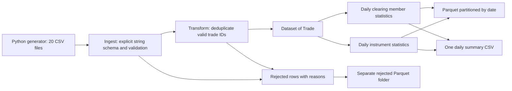

# spark-trade-stats

A small Scala / Apache Spark portfolio project: read generated trade CSVs, reject bad records, remove duplicate trade IDs, and calculate daily trading statistics. It runs on one machine using `local[*]`, without Docker. The data and venue/member names are fictional. This is a learning project, not evidence of work on a live trading system or a distributed deployment.

Repository name: `hamza2829/spark-trade-stats`.



## Run locally

Prerequisites: **Java 17**, **sbt** and **Python 3.9+**. Scala 2.13.16 and Spark 3.5.7 are pinned in `build.sbt`; sbt downloads them. A separate Spark installation is unnecessary. The first build needs an internet connection. [Spark documents Java 17 and Scala 2.13 support](https://spark.apache.org/docs/3.5.7/).

From the project root:

```sh
python scripts/generate_data.py
sbt test
sbt "run config/application.conf"
python scripts/verify_report.py
```

The generator uses seed 42 and creates exactly 200,000 rows across 20 weekdays, starting on 2026-09-01. It skips weekends; it does not implement an exchange holiday calendar. There are 10 symbols, 3 fictional venues and 5 clearing members. Each error category affects 200 rows: missing price, negative quantity, wrong timestamp format and duplicate trade ID. The total includes these rows. The generator refuses to overwrite an existing CSV directory; use `--output data/another-run` and update the config to generate another dataset.

Settings live in [`config/application.conf`](config/application.conf): input directory, output directory and clearing notional threshold. Relative paths resolve from the working directory. Use another config file with `sbt "run path/to/settings.conf"`. Input and output paths must not overlap. Thresholds must be non-negative and fit `DECIMAL(24,2)`. If you change the threshold, pass the same value to the independent checker, e.g. `python scripts/verify_report.py --threshold 300000000.00`.

On Windows, an optional launcher downloads a checksum-pinned sbt launcher and keeps its caches inside the project:

```powershell
$env:JAVA_HOME = 'C:\Program Files\Java\jdk-17' # use your Java 17 directory
python scripts/generate_data.py
.\scripts\sbt.ps1 test
.\scripts\sbt.ps1 'run config/application.conf'
python scripts/verify_report.py
```

Windows local file I/O uses the small [GlobalMentor Java filesystem adapter](https://github.com/globalmentor/hadoop-bare-naked-local-fs), pinned to 0.1.0, so no native filesystem helper installation is needed. `LocalSpark.scala` selects it only on Windows; other systems use Spark's default local filesystem. The adapter does not support symbolic links or the Unix sticky bit, so use ordinary local directories. Startup can still print warnings about missing native helpers; the filesystem adapter handles the file operations.

## Code to explain in an interview

| File | Responsibility |
| --- | --- |
| `Trade.scala` | Case class for a validated trade, with timestamp, decimal price and integer quantity. |
| `Ingest.scala` | CSV I/O at the boundary; pure `validate` and `clean` functions returning DataFrames / `Dataset[Trade]`. |
| `Transform.scala` | Pure deterministic deduplication and daily aggregations. |
| `Output.scala` | Pure daily report construction; a separate `write` method owns filesystem side effects. |
| `Settings.scala` | Read and validate HOCON configuration. |
| `LocalSpark.scala` | Shared local session settings and Windows filesystem adapter selection. |
| `TradeJob.scala` | Start local Spark, cache reused results, reconcile counts, write, read Parquet back, and stop Spark. |

Raw CSV fields use an explicit `StructType` of strings, with no schema inference. Typed conversion happens after reading, so a bad price or timestamp can be rejected with its original value. Headers must match the eight declared columns. Incorrect headers fail the read. Timestamps must be `yyyy-MM-dd'T'HH:mm:ss`, interpreted in UTC. Leading/trailing field whitespace is trimmed. Symbols, venues and members must be present but do not use an external reference list.

Prices must be positive, fit `DECIMAL(12,2)` and have at most two decimal places. Quantities must be integers from 1 to 1,000,000,000; sides must be `BUY` or `SELL`. A rejected row has a `reason` column, with multiple reasons separated by semicolons. Conversion errors use `try_cast` / `try_to_timestamp` even with Spark ANSI mode enabled.

Validation precedes deduplication. For conflicting valid records with the same ID, the earliest timestamp wins; instrument, side, price, quantity, venue and member break ties in that order. Every extra copy goes to the rejected dataset as `duplicate_trade_id`. Identical copies are interchangeable. IDs are considered unique across the entire input batch, rather than unique per date. Duplicate rejections contain normalized values.

Per UTC date and instrument:

- `trade_count` and `total_quantity` count accepted trades and sum quantities.
- `notional` is the sum of `price * quantity`, using decimal arithmetic. It has no currency conversion; the generated prices assume a single currency.
- `vwap = notional / total_quantity`, rounded to six decimal places.
- `high` and `low` are accepted trade prices.
- `buy_sell_ratio = buy_count / sell_count`, using trade counts. With no sells the ratio is null; with sells and no buys it is zero. Both counts are included for clarity.

Per UTC date and clearing member, `daily_notional` sums accepted trades and `above_threshold` is true only when the total is **strictly greater** than the configured threshold. A value equal to the threshold is not flagged. This is a simple demonstration rule.

## Outputs and checks

```text
output/
  instrument_daily/date=2026-09-01/*.parquet
  clearing_daily/date=2026-09-01/*.parquet
  rejected/*.parquet
  summary/part-*.csv
  reconciliation/part-*.json
```

The two daily tables are partitioned by date. Rejected records have their own unpartitioned Parquet folder because some lack a usable date. Spark writes a directory for CSV output; `summary` contains exactly one part CSV with a header and 20 daily rows, plus Spark metadata files. The JSON reconciliation records input, accepted and rejected row counts. The full generated input and local output are gitignored. Small checked examples and measured results are recorded in [`docs/validation.md`](docs/validation.md).

Actual summary excerpt from the default seed/config run:

```csv
date,trade_count,total_quantity,notional,instrument_count,flagged_members
2026-09-01,9960,4994678,1268956803.16,10,4
2026-09-02,9960,4980270,1266805563.42,10,4
2026-09-03,9960,4995710,1258383924.16,10,4
```

The checked run passed all **29 tests** and reconciled **200,000 input = 199,200 accepted + 800 rejected**. The written reports contained total quantity **99,694,970**, total notional **25,393,967,465.67**, 200 instrument rows and 100 clearing-member rows. At the default threshold of 250,000,000.00 there were 72 flagged member-days. The full [20-row sample CSV](docs/sample-summary.csv) is included.

Before writing, the job requires `input_rows = accepted_rows + rejected_rows`. After writing, it reads both Parquet tables and rejected records back, checking accepted trade count, quantity, notional, clearing totals and rejected count. It prints sample instrument statistics and the daily report. The independent Python checker re-reads the generated input with Python's CSV reader, uses `Decimal` arithmetic, and compares every written daily CSV row, member flag count and the reconciliation JSON. That checker targets this generator's four error types; it is not a second general-purpose CSV ingestion engine.

The ScalaTest suite uses local Spark (`local[2]`) and covers cleaning, accumulated rejection reasons, duplicate handling and reconciliation, UTC grouping, VWAP, decimal arithmetic, high/low, buy/sell edge cases, member grouping, threshold boundaries, explicit CSV schema, short rows, empty transformations, summary totals and config validation. GitHub Actions runs `sbt test` on Java 17. The workflow is provided; a local test run does not establish that a remote workflow has run.

## Decisions and limits

One batch job is easy to run and explain, and caching avoids re-reading CSVs for every action. The trade-off is that a failed output stage requires rerunning the batch; the output folders are overwritten independently, without an atomic switch across all tables. Use a dedicated output directory. Running again on the same input replaces the reports; it does not append a second copy.

Date partitioning makes a day's results easy to inspect and avoids partitioning by every symbol. The trade-off is small files at this sample size. The single CSV writer is appropriate for a 20-row summary and would be a bottleneck for a large export. DataFrames keep SQL aggregations simple; `Dataset[Trade]` provides a typed boundary for clean records without adding custom encoders or typed aggregators.

This has been designed for a small, generated local batch. It has no scheduling, streaming ingestion, trade amendments, holiday/currency reference data, incremental checkpoints or distributed runtime validation. CSVs must have the expected header and one record per line; Spark's permissive parser is not a comprehensive validator for arbitrary broken quoting or extra fields. Empty inputs and batches with no valid trades fail before reports are written. Large sums can exceed integer or decimal limits and cause the job to fail under ANSI mode. No performance or latency claims are made.
